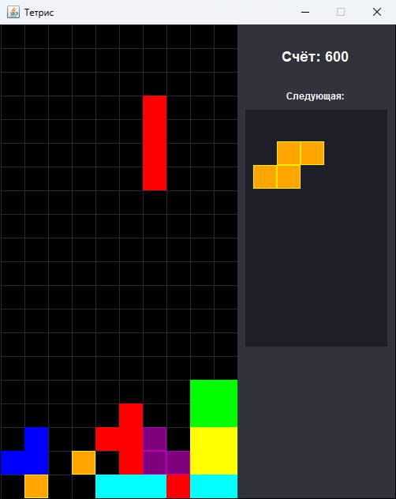

# java-tetris

Тетрис на Java Swing · *Classic Tetris in Java Swing*

`Java` `Swing`

<p align="center"></p>

## Что сделано
- Поле 10×20, все 7 классических фигур, у каждой свой цвет
- Сдвиг, мягкое и жёсткое падение, поворот с отскоком от стены (wall kick: если фигура не помещается, она сдвигается на клетку влево или вправо)
- Удаление заполненных линий, очки по количеству линий за раз: 100 / 300 / 600 / 1000
- Скорость растёт с ростом счёта: интервал таймера уменьшается с 400 до 100 мс
- Боковая панель: текущий счёт и следующая фигура
- Экран GAME OVER и диалог с итоговым счётом

## Структура
```
src/
├── Tetris_gui.java   # окно JFrame, боковая панель (счёт, следующая фигура), точка входа main
├── GameBoard.java    # игровое поле: логика, столкновения, удаление линий, отрисовка, клавиши
└── Tetromino.java    # описание фигур в матрицах 4×4 и их поворот
```

## Управление
| Клавиша | Действие |
|---|---|
| ← → | сдвиг |
| ↑ | поворот |
| ↓ | быстрее вниз |
| Space | сбросить фигуру вниз |

## Запуск
```bash
javac -d out src/*.java
java -cp out Tetris_gui
```

---

## English

Classic Tetris written in Java Swing.

### Features
- 10×20 board with all 7 classic tetrominoes, each in its own colour
- Move, soft drop, hard drop, and rotation with a simple wall kick (a piece that does not fit is shifted one cell left or right)
- Line clearing; clearing 1 / 2 / 3 / 4 lines at once scores 100 / 300 / 600 / 1000 points
- Speed grows with the score: the timer interval drops from 400 ms to 100 ms
- Side panel with the current score and the next piece
- GAME OVER overlay and a final score dialog

### Structure
```
src/
├── Tetris_gui.java   # JFrame window, side panel (score, next piece), main entry point
├── GameBoard.java    # board: game logic, collisions, line clearing, rendering, key handling
└── Tetromino.java    # piece shapes as 4×4 matrices and rotation
```

### Controls
← → move · ↑ rotate · ↓ soft drop · Space hard drop

### Run
```bash
javac -d out src/*.java
java -cp out Tetris_gui
```
